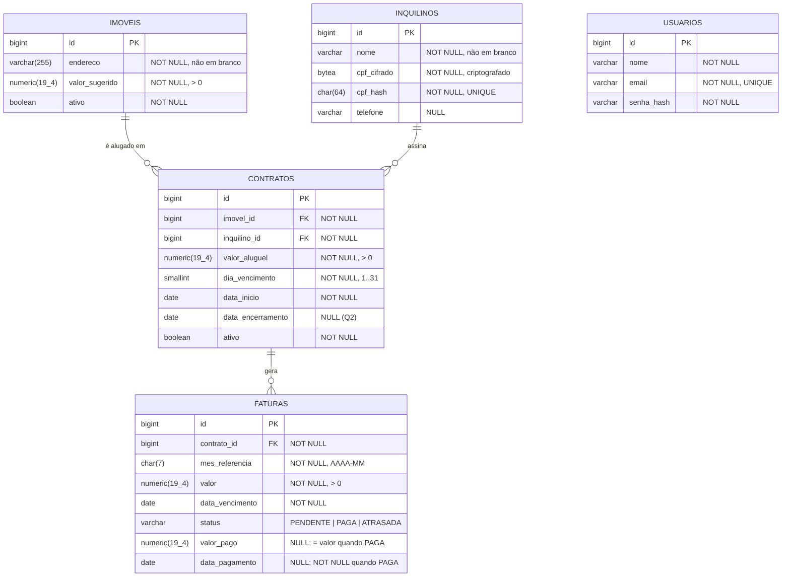

# Revisão de requisitos (RF / RNF) e DER — habitattio

- **Data**: 2026-10-30
- **Base**: `main` (`f076494`) + módulo 1 `001-better-db-schema` (branch
  `worktree-spec-better-db-schema`, ainda **não mergeada** na `main`).
- **Fontes**: AGENTS.md §5–§7, `domain/model/*`, `specs/001-better-db-schema/*`,
  `V1__cria_tabela_imoveis.sql`, memória de decisões de banco (2026-10-29).

Até aqui não existia uma lista consolidada de RF/RNF nem um DER. As regras estavam espalhadas
pelo AGENTS.md, pelos construtores das entidades e pela spec do módulo 1. Este documento junta
tudo, marca o que já está implementado e lista as lacunas que precisam de **decisão do dono**
antes de especificar o próximo módulo.

Legenda de status: ✅ implementado e testado · 🟡 parcial · ❌ não implementado · ❓ precisa de decisão

---

## 1. Requisitos funcionais

### Imóvel (módulo 1)

| ID | Requisito | Status | Onde |
|---|---|---|---|
| RF-01 | Cadastrar imóvel com endereço (obrigatório, não em branco, ≤ 255 caracteres) e valor sugerido (> 0) | ✅ | `POST /imoveis`, `Imovel`, V1 |
| RF-02 | Endereço não é único: vários imóveis podem ter o mesmo endereço | ✅ | spec FR-005 |
| RF-03 | Inativar imóvel (desativação lógica) | 🟡 | só em `Imovel.inativar()`, sem caso de uso nem API |
| RF-04 | Listar e consultar imóveis | ❌ | fora do escopo do módulo 1 |
| RF-05 | Imóvel inativo não recebe novo contrato | ❌ | AGENTS §7; regra entre agregados, vai no caso de uso |

### Inquilino

| ID | Requisito | Status | Onde |
|---|---|---|---|
| RF-06 | Cadastrar inquilino com nome (obrigatório) e CPF (11 dígitos); telefone opcional | 🟡 | só domínio |
| RF-07 | CPF guardado criptografado no banco | ❌ | decisão de 2026-10-29 |
| RF-08 | CPF único entre inquilinos | ❌ | **decidido (Q3)**: `UNIQUE` sobre coluna de hash com chave do CPF |
| RF-09 | ❓ Validar dígito verificador do CPF? Hoje só conta 11 dígitos | ❓ | ver Q4 |

### Contrato

| ID | Requisito | Status | Onde |
|---|---|---|---|
| RF-10 | Criar contrato ligando um imóvel a um inquilino, com valor do aluguel, dia de vencimento (1–31) e data de início | 🟡 | domínio valida **só** o dia de vencimento |
| RF-11 | Valor do aluguel estritamente positivo | ❌ | AGENTS §7 manda, `Contrato` não valida |
| RF-12 | Encerrar contrato (desativação lógica) | 🟡 | `encerrar()` não guarda **quando** encerrou |
| RF-13 | No máximo um contrato ativo por imóvel | ❌ | **decidido (Q1)**: validação no caso de uso + índice único parcial |
| RF-14 | Contrato encerrado não gera novas faturas | ❌ | AGENTS §7 |

### Fatura

| ID | Requisito | Status | Onde |
|---|---|---|---|
| RF-15 | Emitir **automaticamente** a fatura mensal de cada contrato ativo, com o valor do aluguel copiado na emissão | 🟡 | **decidido (Q10)**; `Fatura` existe, não há emissão (ver Q12, Q13) |
| RF-16 | No máximo uma fatura por contrato e competência | ❌ | AGENTS §7; vira `UNIQUE (contrato_id, mes_referencia)` |
| RF-17 | Vencimento = `diaVencimento` do contrato na competência; em mês mais curto, cai no último dia | ❌ | AGENTS §7; ninguém calcula hoje |
| RF-18 | Pagar fatura só com o valor integral; pagamento parcial é rejeitado | ✅ | `Fatura.pagar` (regra está no código e nos testes, mas não no AGENTS §7) |
| RF-19 | Fatura `PAGA` é terminal | ✅ | `FaturaTest` |
| RF-20 | Fatura pendente com vencimento passado vira `ATRASADA`, **gravado por rotina diária** | 🟡 | **decidido (Q5)**; `verificarAtraso(ref)` existe, falta a rotina |
| RF-21 | Fatura atrasada é paga pelo valor original, **sem multa nem juros** | ✅ | **decidido (Q6)**; `devePermitirPagarFaturaQueEstavaAtrasada`. Pagamento a maior já é rejeitado por RF-18 |
| RF-22 | Consultar faturas por status (pendentes, pagas, atrasadas) | ❌ | objetivo do produto (README) |

### Usuário

| ID | Requisito | Status | Onde |
|---|---|---|---|
| RF-23 | Cadastrar usuário operador com nome, e-mail válido e hash de senha | 🟡 | só domínio |
| RF-24 | ❓ Autenticar o usuário (login) | ❓ | ver Q7 |
| RF-25 | E-mail único | ❌ | implícito; vira `UNIQUE` |

---

## 2. Requisitos não funcionais

| ID | Requisito | Status |
|---|---|---|
| RNF-01 | Java 25 + Spring Boot 4.1.2, arquitetura hexagonal, sem framework em `domain/` e `application/` | ✅ |
| RNF-02 | TDD obrigatório; teste escrito e visto falhar é read-only | ✅ processo |
| RNF-03 | SDD: feature nova passa por spec → plan → tasks | ✅ processo |
| RNF-04 | Produção em PostgreSQL; H2 só para uso rápido; modo rápido é o padrão, `prod` explícito | ✅ módulo 1 |
| RNF-05 | Estrutura do banco só por migrações Flyway versionadas; `ddl-auto=validate` em `prod` | ✅ módulo 1 |
| RNF-06 | Invariantes simples (NOT NULL, não vazio, > 0, UNIQUE) também no banco, com constraints nomeadas `pk_`/`ck_`/`uq_`/`fk_` | ✅ só em `imoveis` |
| RNF-07 | Dinheiro em `BigDecimal` no domínio e `numeric(19,4)` no banco | ✅ só em `imoveis` |
| RNF-08 | Nada é apagado de fato: desativação lógica e FKs sem `ON DELETE CASCADE` | 🟡 |
| RNF-09 | Testes de persistência contra PostgreSQL de versão fixa (Testcontainers) | ✅ |
| RNF-10 | Mensagens de erro em português | ✅ domínio |
| RNF-11 | **Erro de validação responde 4xx com mensagem clara**: hoje `IllegalArgumentException` vira **500**, porque não há `@ControllerAdvice` nem `@Valid` | ❌ **defeito no módulo 1** |
| RNF-12 | Dados pessoais (CPF, telefone) protegidos, alinhado à LGPD | ❌ ver Q8 |
| RNF-13 | Credenciais do banco só por variável de ambiente | ✅ `application-prod.properties` |
| RNF-14 | Senha guardada com hash forte e salt | ❓ não há biblioteca de hash no `pom.xml` (ver Q7) |
| RNF-15 | Volume baixo (~14 imóveis, ~14 faturas/mês, um cliente): desempenho não pesa nas decisões | ✅ decisão registrada |
| RNF-16 | ❓ Redis está no stack, mas nada em `src/main` o usa | ❓ ver Q9 |
| RNF-17 | Rotinas automáticas (emissão mensal, atraso diário) são **adapters de entrada** agendados que chamam casos de uso; idempotentes (rodar duas vezes no mesmo dia não duplica fatura nem muda resultado) | ❌ |

---

## 3. DER

### Relacionamentos e cardinalidade

| Relação | Cardinalidade | Leitura | Restrição no banco |
|---|---|---|---|
| Imóvel → Contrato | 1 : 0..N | um imóvel tem vários contratos ao longo do tempo | `fk_contratos_imovel`, `ON DELETE RESTRICT` |
| Inquilino → Contrato | 1 : 0..N | um inquilino pode ter mais de um contrato (outro imóvel ou renovação) | `fk_contratos_inquilino`, `ON DELETE RESTRICT` |
| Contrato → Fatura | 1 : 0..N | uma fatura por competência | `fk_faturas_contrato` + `uq_faturas_contrato_mes (contrato_id, mes_referencia)` |
| Imóvel ↔ Inquilino | N : N, **via Contrato** | `contratos` é a entidade associativa, com atributos próprios | — |
| Usuário | isolado | operador; não se liga a nenhum outro agregado hoje | `uq_usuarios_email` |

**Pontos de revisão do DER:**

1. **Contrato ativo por imóvel (Q1 — decidido: no máximo um).** O PostgreSQL
   aceita um índice único parcial: `CREATE UNIQUE INDEX uq_contratos_imovel_ativo ON contratos
   (imovel_id) WHERE ativo`. É regra entre linhas, mas simples e barata, e protege contra
   dois aluguéis do mesmo imóvel.
2. **`imovel inativo não recebe contrato` e `contrato encerrado não gera fatura`** dependem de
   outra tabela, então pelo critério combinado ficam **só na aplicação**, nos casos de uso.
3. **`Fatura.valor` é cópia, não referência.** Ele copia `contratos.valor_aluguel` na emissão,
   e um reajuste futuro não altera faturas antigas. Está correto, convém só deixar escrito.
4. **`mes_referencia` como `String` no domínio.** Sugestão: `YearMonth` no domínio e
   `char(7)` com `CHECK (mes_referencia ~ '^\d{4}-(0[1-9]|1[0-2])$')` no banco (ou `date` no
   dia 1). Hoje `"2026-13"` ou `"abc"` passam.
5. **Coerência de pagamento no banco.** Um `CHECK` pode garantir que `status = 'PAGA'` ⇔
   `valor_pago` e `data_pagamento` preenchidos. É uma regra simples sobre a própria linha.
6. **CPF criptografado × unicidade (Q3 — decidido: único).** Criptografia com IV aleatório gera um texto cifrado
   diferente a cada gravação, e aí `UNIQUE` sobre ele não funciona. Para o CPF ser único e
   buscável, a saída usual é guardar um **hash com chave (HMAC) do CPF** numa coluna à parte,
   com `UNIQUE`, ao lado do cifrado. Como Q3 = sim, a tabela leva `cpf_cifrado` + `cpf_hash UNIQUE`.
7. **`status` persistido (Q5 — decidido: rotina diária).** `ATRASADA` é gravada por uma
   rotina diária que chama `verificarAtraso(hoje)` nas faturas `PENDENTE` vencidas. Entre o
   vencimento e a próxima execução, a fatura ainda aparece `PENDENTE`: atraso de até um dia,
   aceito pela decisão. `CHECK (status IN ('PENDENTE','PAGA','ATRASADA'))` no banco.

---

## 4. Defeitos e lacunas no código atual

Estes pontos contrariam regra já escrita, então não precisam de decisão. Pelo AGENTS §6 cada
um se corrige em TDD (teste que expõe → falha → correção), não de passagem:

| # | Onde | Problema |
|---|---|---|
| D1 | `Contrato` | não valida `valorAluguel > 0` (AGENTS §7) nem `imovelId`/`inquilinoId`/`dataInicio` não nulos |
| D2 | `Fatura` | construtor não valida nada: `valor` pode ser nulo ou negativo, `contratoId`/`dataVencimento` nulos, `mesReferencia` em qualquer formato |
| D3 | `ImovelController` | erro de domínio responde **500** em vez de 400, e não há `@Valid` no request (RNF-11) |
| D4 | AGENTS.md §6 | afirma que "todas as entidades têm teste cobrindo cada rejeição de invariante", o que não vale para `Contrato` e `Fatura` |
| D5 | AGENTS.md §7 | não registra a regra de **pagamento parcial proibido**, que já está no código |
| D6 | módulo 1 | ainda não mergeado na `main`; o README da branch `worktree-readme` marca o esquema versionado como pendente |

---

## 5. Decisões e perguntas em aberto

### Decididas em 2026-10-30

| # | Pergunta | Decisão |
|---|---|---|
| Q1 | Um imóvel pode ter mais de um contrato ativo ao mesmo tempo? | **Não.** No máximo um (RF-13) |
| Q3 | O CPF é único entre inquilinos? | **Sim** (RF-08) |
| Q5 | `ATRASADA` é persistida ou calculada? | **Persistida, por rotina diária** (RF-20) |
| Q6 | Fatura atrasada tem multa e juros? | **Não** (RF-21) |
| Q10 | A emissão de faturas é manual ou automática? | **Automática** (RF-15) |

### Ainda em aberto

Cada resposta muda regra de cobrança ou estrutura de tabela, e o AGENTS §7 manda perguntar em
vez de inventar.

| # | Pergunta | Sugestão |
|---|---|---|
| Q12 | **Quando** a rotina emite a fatura de uma competência? No dia 1 do mês, ou N dias antes do vencimento? | Dia 1 do mês da competência |
| Q13 | Contrato que começa no meio do mês: a primeira fatura é **proporcional** (pro rata) ou integral? E a do mês do encerramento? | Definir antes do módulo de faturas |
| Q2 | O contrato tem data de término prevista? Guardamos a data de encerramento? | Guardar `data_encerramento` ao encerrar |
| Q4 | Validar o dígito verificador do CPF? | Sim, no domínio |
| Q7 | Haverá login já? Com que hash de senha (BCrypt exige dependência nova)? | Adiar até existir caso de uso |
| Q8 | Telefone também deve ser criptografado? Há prazo de retenção de dados? | Só CPF por enquanto |
| Q9 | Para que serve o Redis? | Se nada precisar, remover do stack (YAGNI) |
| Q11 | Contrato tem reajuste anual? | Fora do escopo agora |

## 6. Próximo passo sugerido

1. Mergear o módulo 1 na `main`.
2. Corrigir D3 (resposta 400) via `/speckit-bug-assess`: é defeito do módulo entregue.
3. Responder Q2 e Q4 (travam `contratos` e `inquilinos`) e Q12–Q13 (travam a emissão de
   `faturas`).
4. Abrir o módulo 2 com `/speckit-specify` (sugestão: **Inquilino + Contrato**, porque Fatura
   depende de Contrato). D1 e D2 entram nessa spec, em TDD.
