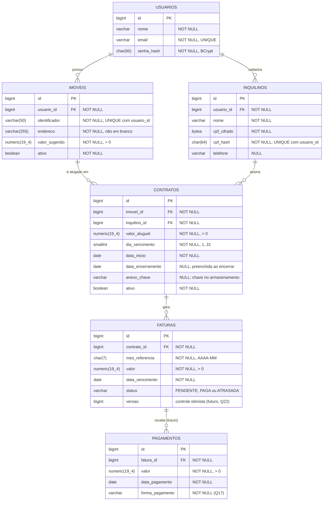

# Requisitos (RF / RNF) e DER — habitattio

- **Atualizado**: 2026-10-30
- **Base**: `main` (`f076494`) + módulo 1 `001-better-db-schema` (branch
  `worktree-spec-better-db-schema`, ainda **não mergeada** na `main`).
- **Fontes**: AGENTS.md §5–§7, `domain/model/*`, `specs/001-better-db-schema/*`,
  `V1__cria_tabela_imoveis.sql`, decisões de banco (2026-10-29), decisões do dono
  (2026-10-30) e o documento do Drive **"Gestor de Aluguéis - Documentação"**
  (`Documentacao_Gestor_Alugueis.md`, gerado em 2026-10-30).

Este documento consolida os requisitos e o DER. Os IDs entre colchetes (`[Drive RF02]`) apontam
o item equivalente no documento do Drive. Quando os dois divergem, vale **este** documento: ele
incorpora as decisões posteriores (seção 5), e a §7 lista o que precisa ser corrigido no Drive.

Legenda de status: ✅ implementado e testado · 🟡 parcial · ❌ não implementado · ❓ precisa de decisão · ⏸ fora do escopo atual

---

## 1. Requisitos funcionais

### Proprietário (usuário) `[Drive RF01]`

| ID | Requisito | Status | Onde |
|---|---|---|---|
| RF-01 | Cadastrar proprietário com nome, e-mail válido e senha (guardada como **hash BCrypt**, nunca recuperável) | 🟡 | `Usuario` só no domínio; **decidido (Q25)** |
| RF-02 | E-mail único entre proprietários | ❌ | `uq_usuarios_email` |
| RF-03 | Login do proprietário | ❌ | **decidido (Q7 + Q14)**; Spring Security aprovado (Q19) |
| RF-04 | **Isolamento de dados**: cada proprietário só vê e altera os próprios imóveis, inquilinos, contratos, faturas e pagamentos | ❌ | **decidido (Q14)** |

### Imóvel `[Drive RF02]`

| ID | Requisito | Status | Onde |
|---|---|---|---|
| RF-05 | Cadastrar imóvel com endereço (obrigatório, não em branco, ≤ 255 caracteres) e valor sugerido (> 0) | ✅ | `POST /imoveis`, `Imovel`, V1 |
| RF-06 | Endereço não é único | ✅ | spec FR-005 |
| RF-07 | Imóvel tem **identificador amigável** (ex.: "Apto 101") além do endereço: obrigatório, não em branco, ≤ 50 caracteres, único por proprietário | ❌ | **decidido (Q15 + Q20)**; migração V2 |
| RF-08 | Imóvel pertence a um proprietário | ❌ | **decidido (Q14)**; `imoveis.usuario_id` |
| RF-09 | Editar imóvel (identificador, endereço, valor sugerido) | ❌ | `[Drive RF02]` |
| RF-10 | Listar e consultar os imóveis do proprietário | ❌ | `[Drive RF02]` |
| RF-11 | Inativar imóvel (desativação lógica) | 🟡 | só `Imovel.inativar()` |
| RF-12 | Imóvel inativo não recebe novo contrato | ❌ | AGENTS §7; no caso de uso |

### Inquilino `[Drive RF03]`

| ID | Requisito | Status | Onde |
|---|---|---|---|
| RF-13 | Cadastrar, editar e listar inquilinos: nome (obrigatório), CPF (11 dígitos), telefone (opcional) | 🟡 | `Inquilino` só no domínio |
| RF-14 | Inquilino pertence a um proprietário | ❌ | **decidido (Q14)**; `inquilinos.usuario_id` |
| RF-15 | CPF guardado criptografado | ❌ | decisão de 2026-10-29 |
| RF-16 | CPF único **por proprietário**: a mesma pessoa pode alugar de dois proprietários | ❌ | **decidido (Q3 + Q14)**; `uq_inquilinos_usuario_cpf (usuario_id, cpf_hash)` |
| RF-17 | Validar o dígito verificador do CPF no domínio | ❌ | **decidido (Q4)** |

### Contrato `[Drive RF04]`

| ID | Requisito | Status | Onde |
|---|---|---|---|
| RF-18 | Criar contrato ligando imóvel e inquilino **do mesmo proprietário**, com valor do aluguel (> 0), dia de vencimento (1–31) e data de início | 🟡 | domínio valida **só** o dia (D1) |
| RF-19 | No máximo um contrato ativo por imóvel | ❌ | **decidido (Q1)**; caso de uso + índice único parcial |
| RF-20 | Anexar o documento do contrato (PDF ou imagem), guardado em disco local em dev, atrás de uma porta de armazenamento | ❌ | **decidido (Q18)**; tamanho máximo fica para o plan |
| RF-21 | Encerrar contrato (desativação lógica), guardando a **data de encerramento** | 🟡 | **decidido (Q2)**; `encerrar()` ainda não guarda a data |
| RF-22 | Contrato encerrado não gera novas faturas | ❌ | AGENTS §7 |

### Fatura

| ID | Requisito | Status | Onde |
|---|---|---|---|
| RF-23 | Emitir **automaticamente** a fatura mensal de cada contrato ativo, **sempre pelo valor integral** do aluguel (sem pro rata, inclusive na primeira e na última), copiado na emissão. A rotina cria a fatura **no dia 1 do mês da competência**; a primeira fatura de um contrato é a do **primeiro vencimento a partir da data de início** (início 20/10, dia 5 → primeira vence 05/11). Se o primeiro vencimento cai no mesmo mês do início (início 03/10, dia 5 → 05/10), a fatura é **criada junto com o contrato** | 🟡 | **decidido (Q10 + Q13 + Q26 + Q27)** |
| RF-24 | No máximo uma fatura por contrato e competência | ❌ | `uq_faturas_contrato_mes` |
| RF-25 | A fatura vence no **dia escolhido em cada contrato** (`diaVencimento`), na competência; em mês mais curto, cai no último dia. Pagar até o vencimento, inclusive, não é atraso (dia 5 → em dia até o dia 5) | ❌ | AGENTS §7 + **decidido (Q12)** |
| RF-26 | Fatura pendente vira `ATRASADA` a partir do **dia seguinte** ao vencimento, gravado por **rotina diária** | 🟡 | **decidido (Q5 + Q12)**; `verificarAtraso` já usa `referencia.isAfter(dataVencimento)`, falta a rotina |
| RF-27 | Sem multa nem juros por atraso | ✅ | **decidido (Q6)** |
| RF-28 | `PAGA` é terminal | ✅ | `FaturaTest` |
| RF-34 | O proprietário **marca a fatura como paga** com uma ação simples (baixa integral, informando a data); substitui o registro de pagamentos enquanto ele estiver fora do escopo | 🟡 | **decidido (Q28)**; `Fatura.pagar` já existe e só aceita o valor integral, falta caso de uso e API |

### Pagamento `[Drive RF06]` — ⏸ fora do escopo atual

> **Decisão de 2026-10-30:** pagamentos **não entram no escopo agora**. Os requisitos abaixo
> ficam registrados para quando o módulo for retomado; nenhum deles será especificado ou
> implementado antes disso. Enquanto isso, a fatura vira `PAGA` pela ação simples de RF-34 (Q28).

| ID | Requisito | Status | Onde |
|---|---|---|---|
| RF-29 | Registrar pagamento de uma fatura com valor (> 0), data e forma de pagamento | ⏸ | `[Drive RF06]`; formas adiadas (Q17) |
| RF-30 | **Pagamento parcial permitido**: uma fatura aceita vários pagamentos e fica `PAGA` quando a soma atinge o valor; parcialmente paga não tem status próprio, mostra o saldo | ⏸ | **decidido (Q16 + Q24)**, para quando o módulo voltar (ver D5) |
| RF-31 | Histórico de pagamentos por fatura | ⏸ | `[Drive RF06]`; tabela `pagamentos` |
| RF-32 | Pagamento acima do saldo devedor | ⏸ | adiado (Q21) |

### Painel `[Drive RF05]`

| ID | Requisito | Status | Onde |
|---|---|---|---|
| RF-33 | Painel mensal do proprietário: faturas da competência com status (pendente, paga, atrasada), valor e saldo | ❌ | `[Drive RF05]` |

---

## 2. Requisitos não funcionais

| ID | Requisito | Status |
|---|---|---|
| RNF-01 | Backend Java 25 + Spring Boot 4.1.2, arquitetura hexagonal, sem framework em `domain/` e `application/` `[Drive RNF02]` | ✅ |
| RNF-02 | TDD obrigatório; teste visto falhar é read-only, salvo decisão explícita do dono | ✅ processo |
| RNF-03 | SDD: feature nova passa por spec → plan → tasks | ✅ processo |
| RNF-04 | Produção em PostgreSQL; H2 só para uso rápido; modo rápido é o padrão, `prod` explícito | ✅ |
| RNF-05 | Estrutura do banco só por migrações Flyway; `ddl-auto=validate` em `prod` | ✅ |
| RNF-06 | Invariantes simples também no banco, com constraints nomeadas `pk_`/`ck_`/`uq_`/`fk_` | ✅ só em `imoveis` |
| RNF-07 | Dinheiro em `BigDecimal` no domínio e `numeric(19,4)` no banco | ✅ só em `imoveis` |
| RNF-08 | Nada é apagado de fato: desativação lógica e FKs `ON DELETE RESTRICT` | 🟡 |
| RNF-09 | Testes de integração contra PostgreSQL de versão fixa (Testcontainers) `[Drive RNF03]` | ✅ |
| RNF-10 | Mensagens de erro em português | ✅ domínio |
| RNF-11 | Erro de validação responde 4xx com mensagem clara | ❌ **defeito D3** |
| RNF-12 | Senha com hash **BCrypt** (salt embutido, custo ajustável), nunca criptografia reversível; autenticação via **Spring Security** `[Drive RNF04]` | ❌ **decidido (Q19 + Q25)** |
| RNF-13 | CPF criptografado no banco (telefone não, por ora); dados pessoais tratados conforme LGPD | ❌ **decidido (Q8)** |
| RNF-14 | Credenciais só por variável de ambiente | ✅ |
| RNF-15 | Toda consulta e escrita filtra pelo proprietário autenticado; um proprietário nunca acessa dado de outro, nem por id adivinhado | ❌ (Q14) |
| RNF-16 | Rotinas automáticas (emissão mensal, atraso diário) são adapters de entrada agendados que chamam casos de uso, e são idempotentes | ❌ |
| RNF-17 | Pagamentos simultâneos na mesma fatura não podem ultrapassar o saldo: **versão otimista no banco** (`faturas.versao`) | ⏸ **decidido (Q22)**, com o módulo de pagamentos |
| RNF-18 | Frontend Next.js (App Router) + Tailwind, **mobile-first**, em **repositório separado** `[Drive RNF01]`; o backend expõe API REST consumível por ele | ❌ **decidido (Q23)** |
| RNF-19 | Redis para cache e locks `[Drive §3]` | ❓ ver Q22 |
| RNF-20 | Docker Compose para subir o ambiente; CI no GitHub Actions `[Drive §3]` | ❌ |
| RNF-21 | Volume baixo: desempenho não pesa nas decisões | ✅ decisão registrada |

---

## 3. DER

### Relacionamentos e cardinalidade

| Relação | Cardinalidade | Restrição no banco |
|---|---|---|
| Usuário → Imóvel | 1 : 0..N | `fk_imoveis_usuario`; `uq_imoveis_usuario_identificador (usuario_id, identificador)` |
| Usuário → Inquilino | 1 : 0..N | `fk_inquilinos_usuario`; `uq_inquilinos_usuario_cpf (usuario_id, cpf_hash)` |
| Imóvel → Contrato | 1 : 0..N, no máximo 1 ativo | `fk_contratos_imovel`; `CREATE UNIQUE INDEX uq_contratos_imovel_ativo ON contratos (imovel_id) WHERE ativo` |
| Inquilino → Contrato | 1 : 0..N | `fk_contratos_inquilino` |
| Contrato → Fatura | 1 : 0..N, uma por competência | `fk_faturas_contrato`; `uq_faturas_contrato_mes (contrato_id, mes_referencia)` |
| Fatura → Pagamento | 1 : 0..N — **⏸ fora do escopo atual** | `fk_pagamentos_fatura` |
| Imóvel ↔ Inquilino | N : N **via Contrato** | — |

Todas as FKs são `ON DELETE RESTRICT`, porque nada é apagado de fato.

### Decisões de modelagem

1. **Dono só em `imoveis` e `inquilinos`.** Contratos, faturas e pagamentos chegam ao
   proprietário pela cadeia de FKs, sem coluna `usuario_id` repetida. A regra "imóvel e
   inquilino do contrato são do mesmo proprietário" depende de duas tabelas. Por isso fica no
   caso de uso (RF-18), pelo critério combinado de 2026-10-29.
2. **`valor_pago` e `data_pagamento` saem de `faturas`.** Com pagamento parcial (Q16), o valor
   pago é a soma de `pagamentos` e o saldo é `valor − soma`. A fatura vira `PAGA` quando o
   saldo chega a zero. Isso substitui os campos atuais de `Fatura` (D5).
3. **`Fatura.valor` é cópia** do `valor_aluguel` na emissão. Um reajuste futuro não altera
   faturas antigas.
4. **`mes_referencia`**: `YearMonth` no domínio, `char(7)` com
   `CHECK (mes_referencia ~ '^\d{4}-(0[1-9]|1[0-2])$')` no banco. Hoje é `String` livre (D2).
5. **`status`** é gravado pela rotina diária (Q5), com
   `CHECK (status IN ('PENDENTE','PAGA','ATRASADA'))`. Uma fatura parcialmente paga continua
   `PENDENTE` ou `ATRASADA` até quitar, sem status próprio (Q24). Isso vale quando pagamentos
   voltarem ao escopo; até lá, `pagamentos` e a coluna `versao` não são criadas.
6. **CPF**: `cpf_cifrado` (criptografia com IV aleatório) + `cpf_hash` (HMAC com chave),
   que permite unicidade e busca sem expor o CPF.
7. **Anexo do contrato**: o arquivo não vai para o banco. A tabela guarda só a chave ou o
   caminho no armazenamento (Q18), atrás de uma porta outbound `ArmazenamentoArquivoPort`.

---

## 4. Defeitos e lacunas no código atual

Pelo AGENTS §6, cada item se corrige em TDD, não de passagem.

| # | Onde | Problema |
|---|---|---|
| D1 | `Contrato` | não valida `valorAluguel > 0` nem `imovelId`/`inquilinoId`/`dataInicio` não nulos |
| D2 | `Fatura` | construtor não valida nada; `mesReferencia` é `String` livre |
| D3 | `ImovelController` | erro de domínio responde **500** em vez de 400; sem `@Valid` |
| D4 | AGENTS.md §6 | diz que todas as entidades têm teste para cada invariante, o que não vale para `Contrato` e `Fatura` |
| D5 | `Fatura.pagar` | proíbe pagamento parcial, o que agora contraria Q16. Os testes `deveRejeitarPagamentoParcial` e `deveRegistrarValorPagoEDataDePagamentoAoPagar` vão mudar **por decisão explícita do dono (2026-10-30)**. A mudança entra pela spec do módulo de pagamentos, não antes. **Com pagamentos fora do escopo (2026-10-30), `Fatura.pagar` e seus testes ficam como estão** |
| D6 | AGENTS.md §6 e memória do projeto | descrevem `Usuario` como "operador do sistema" de um único cliente, o que agora contraria Q14 |
| D7 | módulo 1 | `imoveis` não tem `usuario_id` nem `identificador`; precisa de migração V2 (sem dados de produção, sem migração de dados) |
| D8 | módulo 1 | ainda não mergeado na `main` |

---

## 5. Decisões do dono

| # | Data | Pergunta | Decisão |
|---|---|---|---|
| Q1 | 2026-10-30 | Mais de um contrato ativo por imóvel? | **Não** |
| Q3 | 2026-10-30 | CPF único? | **Sim**, por proprietário (Q14) |
| Q5 | 2026-10-30 | `ATRASADA` persistida ou calculada? | **Persistida, rotina diária** |
| Q6 | 2026-10-30 | Multa e juros no atraso? | **Não** |
| Q7 | 2026-10-30 | Haverá login? | **Sim** (`[Drive RF01]`) |
| Q9 | 2026-10-30 | Para que serve o Redis? | **Cache e locks** (`[Drive §3]`); uso concreto em Q22 |
| Q10 | 2026-10-30 | Emissão de faturas manual ou automática? | **Automática** |
| Q14 | 2026-10-30 | Um cliente ou vários proprietários? | **Multi-proprietário, com isolamento de dados** |
| Q15 | 2026-10-30 | Identificador amigável × endereço? | **Os dois**: mantém `endereco` e adiciona `identificador` |
| Q16 | 2026-10-30 | Um pagamento integral ou vários parciais? | **Vários parciais**; autoriza mudar os testes de `Fatura.pagar` (D5) |
| Q19 | 2026-10-30 | Acordo para a dependência de autenticação? | **Aprovado: Spring Security** (acordo do AGENTS §9) |
| Q20 | 2026-10-30 | Regras do `identificador`? | **Obrigatório, ≤ 50 caracteres, único por proprietário** |
| Q12 | 2026-10-30 | Quando a fatura vence? | **No dia escolhido em cada contrato**. Ex.: dia 5 → pagar até o dia 5 não atrasa |
| Q13 | 2026-10-30 | Primeira e última fatura proporcionais ou integrais? | **Integrais** |
| Q26 | 2026-10-30 | Quando a fatura é criada e qual é a primeira? | **Criada no dia 1** do mês da competência; a primeira é a do **primeiro vencimento a partir da data de início** (início 20/10, dia 5 → 05/11) |
| Q27 | 2026-10-30 | Primeiro vencimento no mesmo mês do início, depois do dia 1? | **A fatura é criada junto com o contrato** |
| Q2 | 2026-10-30 | Guardar a data de encerramento do contrato? | **Sim** |
| Q4 | 2026-10-30 | Validar o dígito verificador do CPF? | **Sim**, no domínio |
| Q8 | 2026-10-30 | Telefone também criptografado? | **Não**; só o CPF por enquanto |
| Q11 | 2026-10-30 | Reajuste anual do contrato? | **Fora do escopo agora** |
| Q18 | 2026-10-30 | Onde guardar o anexo do contrato? | **Disco local em dev**, atrás de porta; tamanho máximo no plan |
| Q22 | 2026-10-30 | Concorrência de pagamentos? | **Versão otimista no banco** (vale quando pagamentos voltarem) |
| Q23 | 2026-10-30 | Frontend no mesmo repositório? | **Não**, repositório separado |
| Q24 | 2026-10-30 | Status próprio para fatura parcialmente paga? | **Não**, basta mostrar o saldo (vale quando pagamentos voltarem) |
| — | 2026-10-30 | Pagamentos entram no escopo? | **Não, por enquanto.** Q17 (formas de pagamento) e Q21 (pagamento acima do saldo) ficam adiadas |
| Q28 | 2026-10-30 | Sem pagamentos, como a fatura vira `PAGA`? | **O próprio proprietário marca como paga**, com uma ação simples (RF-34) |
| Q25 | 2026-10-30 | Senha com hash ou criptografia? | **Hash BCrypt**. Criptografia foi considerada e descartada: é reversível, e se a chave vazar todas as senhas aparecem |

## 6. Perguntas em aberto

Nenhuma no escopo atual.

### Adiadas (voltam com o módulo de pagamentos)

| # | Pergunta | Sugestão anterior |
|---|---|---|
| Q17 | Formas de pagamento aceitas? | `PIX`, `DINHEIRO`, `TRANSFERENCIA`, `BOLETO` |
| Q21 | Pagamento acima do saldo devedor: rejeitar ou aceitar como crédito? | Rejeitar |

---

## 7. Divergências com o documento do Drive

O que corrigir em "Gestor de Aluguéis - Documentação" para ele ficar consistente:

| Ponto do Drive | Problema | Correção |
|---|---|---|
| DER: linha `Imovel 1 — 1 Inquilino` | imóvel e inquilino não se ligam diretamente; a relação N:N passa por Contrato | remover a linha; desenhar `Imovel 1 — * Contrato` |
| DER: falta a linha `Imovel → Contrato` | `contratos.imovel_id` aparece como FK, mas sem relacionamento desenhado | adicionar |
| `Inquilino` sem `usuario_id` | com multi-proprietário, um dono veria inquilinos do outro (fere `[Drive RF01]`, isolamento) | adicionar `usuario_id` |
| `Contrato.contrato_url` | URL fixa expira ou expõe o arquivo | guardar chave do armazenamento; a URL é gerada na leitura |
| `Historico` | nome genérico | renomear para `Pagamento` (vocabulário do negócio, AGENTS §5) |
| `Fatura` no desenho | falta `data_vencimento` (aparece só na lista de tabelas) | adicionar no desenho |
| `Contrato` | falta `data_encerramento` | adicionar (Q2 = sim) |
| RNF04 "criptografia de senhas" | senha não se criptografa, se guarda como **hash** (Q25) | "hash de senha BCrypt" |
| Ausentes no Drive | regras de cobrança decididas: uma fatura por competência, vencimento no último dia em mês curto, emissão automática, rotina diária de atraso, sem multa/juros, pagamento parcial, um contrato ativo por imóvel, CPF criptografado e único por proprietário | incluir ou apontar para este documento |

---

## 8. Próximos passos sugeridos

1. Mergear o módulo 1 na `main`.
2. Corrigir D3 (resposta 400) via `/speckit-bug-assess`.
3. ~~Responder Q19 e Q20~~ (respondidas): o módulo 2 está desbloqueado.
4. **Módulo 2 — Proprietário e isolamento** (`/speckit-specify`): cadastro e login do
   proprietário, `usuario_id` e `identificador` em `imoveis` (V2), filtro por dono. Vem antes
   de tudo, porque todo agregado depende do dono.
5. Módulo 3 — Inquilino + Contrato (D1).
6. Módulo 4 — Faturas e painel: emissão automática, rotina de atraso, marcar como paga e painel mensal (D2).
7. ⏸ Módulo 5 — Pagamentos parciais (**fora do escopo atual**; D5, Q17, Q21).
8. Atualizar AGENTS.md §6–§7 (D4, D6) quando o módulo 2 for especificado.
